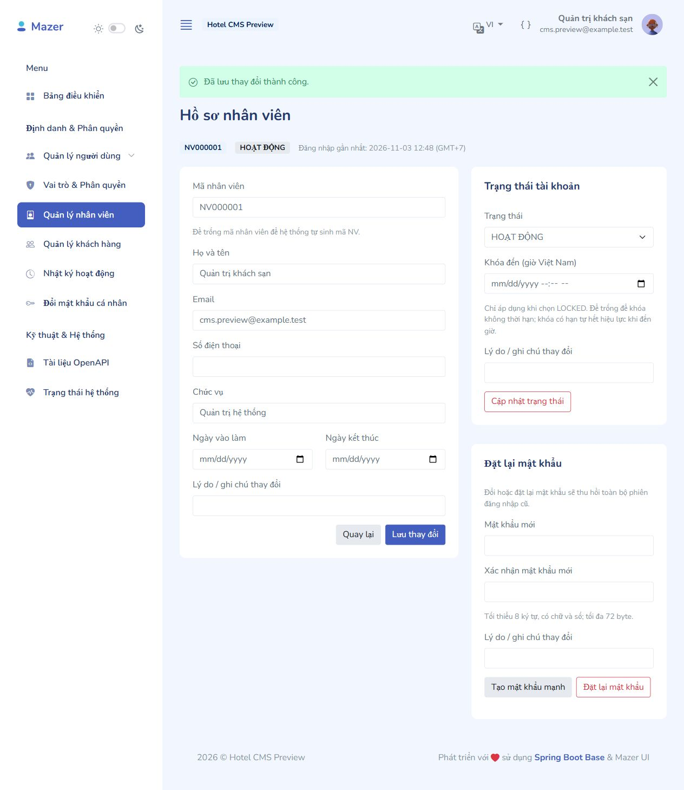
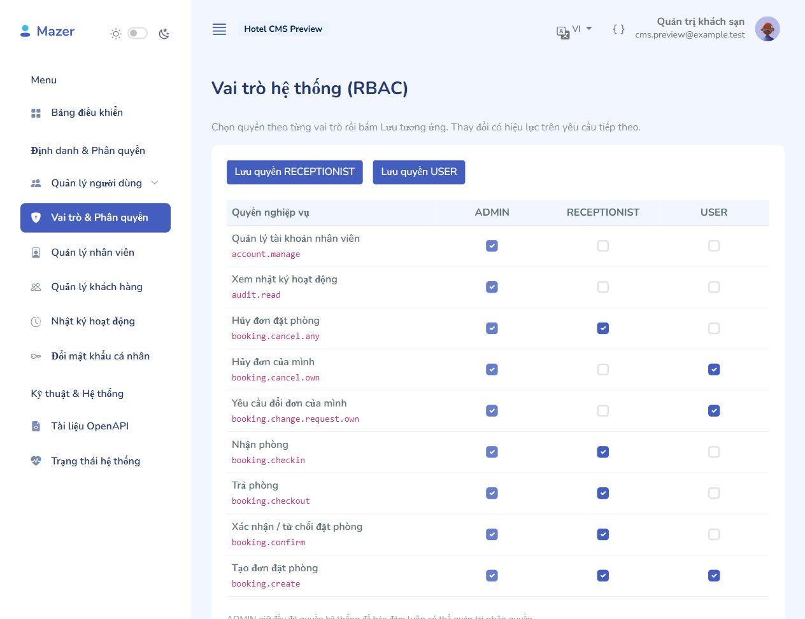
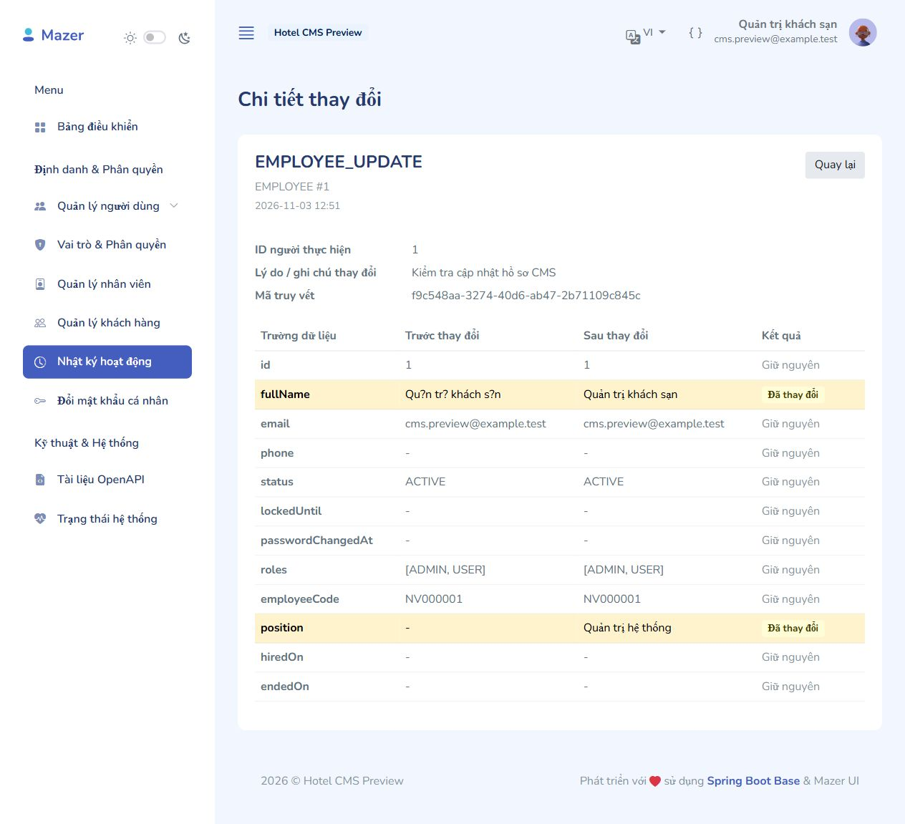

# CMS quản lý tài khoản và phân quyền

Mô-đun đầu tiên của CMS admin theo PLAN: đăng nhập/đăng xuất, nhân viên, khách hàng, RBAC, mật khẩu, trạng thái tài khoản và nhật ký hoạt động. Sử dụng giao diện Mazer đang có, tiếng Việt/Anh và Spring Security session + CSRF. Các module lễ tân đặt phòng/check-in/check-out, API nghiệp vụ mới và ghép React FE thuộc các bước tiếp theo.

## Chạy và sử dụng

Chạy tại thư mục backend:

```powershell
.\mvnw.cmd spring-boot:run
```

Mở `http://localhost:8080/admin/login` và dùng tài khoản đang có. Đăng nhập lại sau khi cập nhật phiên bản CMS để nạp principal và quyền mới. Flyway tự áp dụng V4 nếu chưa chạy; không cần import lại database.

| Địa chỉ | Màn hình / quyền |
|---|---|
| `/admin` | Dashboard quản trị; lễ tân được chuyển đến không gian riêng |
| `/admin/receptionist` | Điểm vào CMS của RECEPTIONIST trong mô-đun tài khoản hiện tại |
| `/admin/users` | Tài khoản tổng hợp và gán role; ADMIN + `account.manage` |
| `/admin/employees` | Danh sách, tìm kiếm tên/mã/email/điện thoại/chức vụ, lọc trạng thái; `account.manage` |
| `/admin/employees/create` | Tạo đồng thời User và Employee, mật khẩu BCrypt, mặc định RECEPTIONIST |
| `/admin/employees/{id}/edit` | Sửa liên hệ/công tác, trạng thái và thời hạn khóa; admin đặt lại mật khẩu |
| `/admin/customers` | Danh sách/tìm kiếm/lọc quốc tịch; `customer.read` |
| `/admin/customers/create` | Thêm khách vãng lai không bắt buộc tài khoản; `customer.update` |
| `/admin/customers/{id}` | Hồ sơ khách hàng và thông tin giấy tờ đã che bớt |
| `/admin/customers/{id}/edit` | Sửa hồ sơ, ghi chú, thay/xóa số giấy tờ; `customer.update` |
| `/admin/roles` | Ma trận 45 quyền cho ADMIN/RECEPTIONIST/USER; ADMIN + `role.manage` |
| `/admin/profile/password` | Đổi mật khẩu cá nhân, yêu cầu mật khẩu hiện tại; `profile.manage.own` |
| `/admin/audit-logs` | Lọc hành động/đối tượng/người thực hiện/ngày; `audit.read` |
| `/admin/audit-logs/{id}` | So sánh trước/sau, tô nổi bật trường thay đổi |

Thêm/sửa/trạng thái/mật khẩu/phân quyền dùng POST có CSRF. GET không thay đổi nghiệp vụ. Các form có validation tại server, thông báo Việt/Anh và phân trang giữ bộ lọc. Ngày giờ giao diện CMS hiển thị theo GMT+7; timestamp lưu UTC.

## Nhân viên và khách hàng

- Mã nhân viên để trống sẽ sinh dạng `NV000001` từ ID hồ sơ; có thể nhập mã riêng và database bảo đảm UNIQUE. Mã khách mới dạng `KH000001`. Mã hồ sơ cũ backfill bởi V4 có tiền tố `NV-U` / `KH-U` để không đụng dãy mới.
- Tạo tài khoản qua quản trị hoặc đăng ký USER sẽ đồng thời tạo hồ sơ phù hợp; thay đổi vai trò có thể bổ sung Employee/Customer tương ứng. Hồ sơ và lịch sử được giữ lại khi bỏ một vai trò.
- Ngày kết thúc công việc không được trước ngày vào làm. Email và điện thoại tài khoản nhân viên không được trùng tài khoản khác. Nhân viên mặc định có role RECEPTIONIST, không tự nhận ADMIN từ form nhân viên.
- Hồ sơ Customer có thể không liên kết User. Sửa email liên hệ của Customer không thay email đăng nhập của tài khoản liên kết, tránh lẫn quyền chăm sóc khách và quản lý tài khoản.
- Có thể tìm số CCCD/Passport theo số đầy đủ qua HMAC; database không lưu số ở dạng rõ. Màn hình chỉ hiển thị 4 ký tự cuối. Để trống số khi sửa nghĩa là giữ số cũ; thay loại giấy tờ cần nhập số mới hoặc chọn xóa.

## Phân quyền và phiên đăng nhập

- `CustomUserDetails` nạp cả `ROLE_*` và permission codes từ `role_permissions`. CMS cho ADMIN/RECEPTIONIST vào theo quyền; USER không vào CMS. Menu và endpoint/service đều kiểm tra quyền, không chỉ ẩn nút.
- Ma trận cho chỉnh quyền RECEPTIONIST/USER. ADMIN giữ đủ quyền hệ thống để tránh tự mất khả năng quản trị. Các quyền dành cho module khách sạn tiếp theo đã có trong ma trận, chưa tạo ra các chức năng nghiệp vụ chưa triển khai.
- Lễ tân được ủy quyền `account.manage` vẫn không được sửa tài khoản ADMIN. Reset mật khẩu nhân viên chỉ dành cho ADMIN, bắt buộc lý do. Đổi mật khẩu của chính mình phải dùng luồng có mật khẩu hiện tại.
- Không cho tự bỏ ADMIN, tự khóa/vô hiệu hóa tài khoản quản trị; giữ ít nhất một admin hoạt động. Các thay đổi vai trò/trạng thái quản trị được điều phối bằng khóa role ADMIN.
- Mỗi tài khoản có `security_version`. Đổi/reset mật khẩu, thay thông tin xác thực hoặc trạng thái sẽ tăng version, thu hồi refresh tokens/account tokens và hết hiệu lực session cũ. JWT kiểm tra version hiện tại; kích hoạt lại không làm sống lại token cũ.
- Session guard đọc lại trạng thái và quyền từ database trên mỗi request, nên việc thu hồi quyền có hiệu lực ngay cả khi phiên đã mở. SessionRegistry được đánh dấu hết hạn sau khi giao dịch commit, tránh logout do giao dịch đã rollback.
- Khóa `LOCKED` không có hạn là khóa vô thời hạn. Có `locked_until` thì sau thời hạn tài khoản có thể đăng nhập; lần đăng nhập thành công chuyển lại ACTIVE và ghi audit `ACCOUNT_LOCK_EXPIRED`.
- `DISABLED` và `INACTIVE` không được đăng nhập. INACTIVE được giữ để tương thích dữ liệu/giao diện cũ. Session timeout tiếp tục dùng 30 phút như cấu hình nền.

## Mật khẩu và giấy tờ định danh

Mật khẩu có ít nhất 8 ký tự, chữ và số; không quá 72 byte UTF-8 do giới hạn BCrypt. Xác nhận mật khẩu phải khớp. Nút tạo mật khẩu sinh 20 ký tự bằng Web Crypto trên trình duyệt, không ghi vào audit. Mật khẩu mới phải khác mật khẩu cũ.

`CUSTOMER_DOCUMENT_ENCRYPTION_KEY` là khóa base64 của 32 byte dành riêng cho AES-256-GCM. Khóa local đã được cấu hình riêng trong file `.env` không được Git theo dõi; test dùng khóa riêng cho dữ liệu giả. `.env.example` chỉ có tên biến trống. Cần giữ khóa ổn định và sao lưu cùng quy trình sao lưu database; thay khóa cần quy trình mã hóa lại dữ liệu. Không dùng JWT key làm khóa giấy tờ.

AES-GCM dùng nonce ngẫu nhiên cho mỗi lần mã hóa; HMAC tìm kiếm dùng khóa được tách miền từ khóa mã hóa. Form sửa không đưa số đầy đủ trở lại HTML và không lưu số vào audit. Các API tương lai cần tiếp tục dùng DTO an toàn, không trả entity hoặc ciphertext ra ngoài.

## Audit và transaction

Sự kiện audit được phát qua Spring ApplicationEvent và lưu đồng bộ trong transaction nghiệp vụ. Đây là lựa chọn chủ đích so với gợi ý `@Async` trong PLAN: nếu tạo/sửa thất bại, cả dữ liệu và audit đều rollback; không có thay đổi thành công nhưng mất log do worker chưa ghi.

Đã nối các hành động tạo/sửa tài khoản, tạo/sửa nhân viên/khách, đổi/reset mật khẩu, đổi trạng thái, đổi ma trận quyền, login/logout và hết hạn khóa. Actor, IP, mã truy vết và thời gian được thu thập từ ngữ cảnh yêu cầu. Snapshot chỉ lấy trường được phép; bộ lọc đệ quy loại password/hash/token/secret/giấy tờ khỏi cả map và danh sách lồng nhau. Audit chỉ có chức năng đọc trên CMS.

Khi triển khai giá/hủy đơn/trạng thái phòng sau này, gọi `AuditLogService.record(...)` từ service đang có `@Transactional`, dùng snapshot riêng an toàn cho nghiệp vụ đó.

## Migration và kiểm chứng

`V4__cms_identity_and_account_security.sql` bổ sung:

- `users.security_version`, CHECK không âm.
- `customers.document_type`, `document_number_encrypted`, `document_number_hash` và index tìm kiếm.
- Hồ sơ nhân viên/khách tương ứng cho các tài khoản cũ, không gán thêm role, không đổi mật khẩu hay xóa dữ liệu.

Sau V4 vẫn có 59 bảng ứng dụng, 125 FK, tăng lên 80 CHECK và 618 cột. Không sửa V1–V3.

```powershell
.\mvnw.cmd test
.\mvnw.cmd package
```

Các bộ test chính: `CmsAdminModuleIntegrationTest`, `AdminWebSecurityIntegrationTest`, `EmployeeServiceTest`, `CustomerServiceTest`, `IdentityDocumentCryptoTest`, `AuditLogServiceTest`, `HotelSchemaMigrationTest` và các test xác thực/API cũ.

Nghiệm thu gồm cả rollback User + Employee + audit khi mã bị trùng, chống truy cập sai quyền, self-lock, mã hóa/che/tìm giấy tờ, session/JWT/refresh token sau reset, đổi quyền trên session đang mở, đa ngôn ngữ và render tất cả route mới. Kiểm thử mặc định dùng H2 riêng; test MySQL yêu cầu opt-in bằng biến `HOTEL_MYSQL_TEST_URL` như tài liệu DATABASE.md.

Ảnh giao diện được chụp trên instance H2 riêng với tài khoản mẫu, không phải dữ liệu khách sạn:







Kết quả nghiệm thu: Maven package BUILD SUCCESS; 43 kiểm thử mặc định đạt (1 test MySQL opt-in không chạy trong lệnh mặc định), bộ test MySQL riêng 3/3 đạt. Tổng cộng 44 test độc lập đã được chạy thành công khi tính cả test MySQL bổ sung. Backend local trả health UP. Xem cms-verification.json.

## Phần 2 – Khách sạn và phòng

Đã bổ sung cấu hình khách sạn, tầng/khu vực, tiện nghi, loại phòng/ảnh, phòng vật lý, bảo trì, hồ sơ lịch sử và sơ đồ phòng. Xem [hướng dẫn phần 2](CMS_HOTEL_ROOMS.md). Flyway bổ sung migration V5, không thay đổi V1–V4.

## Phần 3 – Giá phòng và khuyến mãi

Đã bổ sung bảng giá, quy tắc cuối tuần/mùa/dài ngày, voucher, chính sách cọc/hủy/phụ phí và bộ mô phỏng theo từng đêm. Xem [hướng dẫn phần 3](CMS_PRICING_PROMOTIONS.md). Không cần migration mới.
