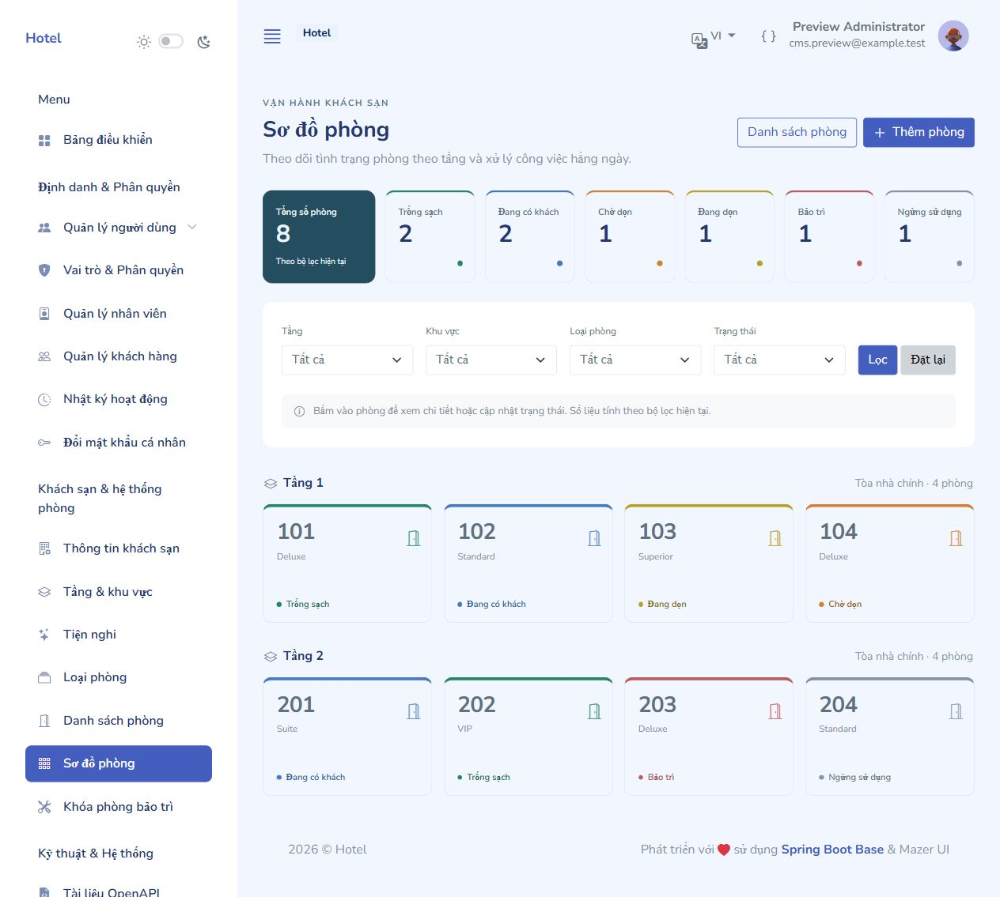
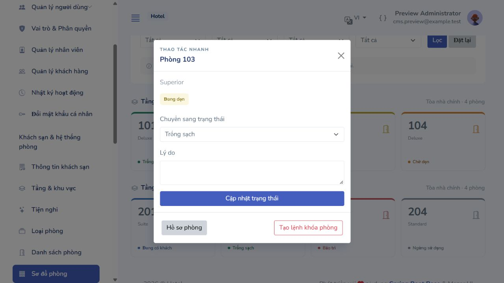

# CMS Admin – Khách sạn và hệ thống phòng (phần 2)

Đã triển khai trên BE hiện có: Java 17, Spring Boot 4, JPA/JDBC, Flyway, Thymeleaf/Mazer, session + CSRF và quyền API của mô-đun tài khoản. Các màn hình có tiếng Việt/Anh, dùng chung sidebar và nhật ký hoạt động.

## Chạy và mở CMS

Từ thư mục `backend`:

```powershell
.\mvnw.cmd spring-boot:run
```

Đăng nhập tài khoản ADMIN tại `http://localhost:8080/admin/login`. Flyway tự áp dụng `V5__seed_hotel_and_room_catalogues.sql`; giữ nguyên V1–V4 và dữ liệu hiện có. Không import lại hoặc xóa database. Nếu ứng dụng đang chạy bằng IDE, khởi động lại để nạp các lớp mới.

V5 bổ sung cấu hình khách sạn `id=1` nếu chưa có, chính sách tham chiếu không thu cọc/phí hủy, 5 hạng phòng và 7 tiện nghi khi danh mục tương ứng còn trống. Không sinh tầng, phòng hay lượt lưu trú mẫu trong database thật. Giá khởi tạo là 0; quản trị viên cần nhập tên/địa chỉ, chính sách thực tế và giá trước khi mở bán.

| Đường dẫn | Chức năng | Quyền |
|---|---|---|
| `/admin/hotel` | Tên, địa chỉ, hotline, email, mô tả, logo URL/upload, giờ nhận/trả, thời gian giữ chỗ, VAT và chính sách mặc định | `hotel.manage` |
| `/admin/floors` | Thêm/sửa/xóa tầng, khu vực, thứ tự và số phòng của tầng | `room.manage` |
| `/admin/amenities` | Thêm/sửa/xóa/bật/tắt tiện nghi và biểu tượng Bootstrap | `room.manage` |
| `/admin/room-types` | Danh sách hạng phòng, giá, sức chứa, tiện nghi và ảnh bìa | `room.manage` |
| `/admin/room-types/{id}/edit` | Sửa thông tin, thêm nhiều ảnh, nhập vị trí, đặt ảnh bìa, xóa ảnh | `room.manage` |
| `/admin/rooms` | Tìm số phòng, lọc tầng/khu vực/loại/trạng thái, danh sách phân trang | `room.read` |
| `/admin/rooms/create`, `/{id}/edit` | Thêm/sửa phòng vật lý, loại, tầng, ngày bán và ghi chú | `room.manage` |
| `/admin/rooms/{id}` | Hồ sơ phòng, tiện nghi, lịch sử lưu trú, bảo trì, thay đổi trạng thái | `room.read` |
| `/admin/rooms/grid` | Sơ đồ theo tầng, KPI theo bộ lọc và modal thao tác nhanh | `room.read` |
| POST `/admin/rooms/{id}/status` | Đổi trạng thái kèm lý do và phiên bản phòng | `room.status.update` |
| POST `/admin/rooms/{id}/retire`, `/{id}/delete` | Ngừng sử dụng hoặc xóa phòng chưa có nghiệp vụ liên quan | `room.manage` |
| `/admin/room-blocks` | Tạo khóa theo ngày, xem lệnh khóa, mở khóa sớm | `room.block.manage` |

ADMIN có sẵn các quyền này. RECEPTIONIST mặc định được xem phòng và đổi trạng thái; không được chỉnh danh mục, cấu hình khách sạn, tạo khóa bảo trì hoặc mở lại phòng mà admin đã ngừng sử dụng. Có thể gán thêm quyền qua màn hình RBAC. Kiểm tra quyền được thực hiện cả ở controller và service; ẩn menu không thay thế kiểm tra server.

## Hướng dẫn thao tác

1. Cập nhật **Thông tin khách sạn**. Tên và logo mới được đọc lại trên các trang CMS, không cần khởi động lại. Múi giờ và tiền tệ được hiển thị từ cấu hình hiện hành; form này không đổi hai giá trị đó khi đã có dữ liệu đặt phòng.
2. Tạo **Tầng & khu vực**, kiểm tra **Tiện nghi**, chỉnh **Loại phòng** và giá cơ bản. Tổng khách tối đa không nhỏ hơn giới hạn người lớn, và không lớn hơn tổng giới hạn người lớn + trẻ em.
3. Lưu loại phòng rồi thêm ảnh trong phần **Thư viện ảnh**. Mỗi dòng một URL hoặc tải nhiều tệp. Vị trí bắt đầu từ 0; ảnh ở vị trí 0 là ảnh bìa.
4. Thêm **Phòng** và gán tầng/loại phòng. Số phòng là duy nhất; ngày ngừng bán phải sau ngày bắt đầu, và không được thu hẹp lịch bán làm xung đột lịch khách/bảo trì.
5. Vào **Sơ đồ phòng** để lọc và đổi trạng thái. Màu luôn đi kèm chữ, không chỉ dựa vào màu. KPI phản ánh tập phòng đang lọc. Khách đang ở và ngày trả dự kiến lấy từ lượt phân phòng thực tế, không tạo tên khách giả khi chỉ đổi trạng thái thủ công.
6. Khi sửa chữa, tạo **Khóa phòng bảo trì** với khoảng `[từ ngày, đến ngày)`. Khóa bắt đầu hôm nay chuyển sang bảo trì; khóa tương lai giữ nguyên trạng thái hiện tại. Mở khóa hiện tại đưa phòng về **Đang dọn**; hoàn tất dọn mới chuyển sang **Trống sạch**.

Luồng trạng thái thông thường: trống sạch → có khách → chờ dọn → đang dọn → trống sạch. Không cho đi thẳng từ phòng bẩn sang sẵn sàng/có khách. Bảo trì phải đi qua lệnh khóa có ngày; không cho đổi tay sang trống khi khóa vẫn hiệu lực. Ngừng sử dụng chỉ thực hiện khi không còn khách, lịch gán tương lai hay khóa tương lai. Phòng đã lưu trú/bảo trì được giữ lại bằng ngừng sử dụng thay vì xóa.

Đổi trạng thái thủ công ở CMS chưa tạo booking, gán phòng hoặc check-in/check-out. Khi có lượt lưu trú thực tế đang mở, không cho bỏ qua quy trình trả phòng bằng cách đổi trạng thái tay. Phần nghiệp vụ lễ tân/đặt phòng và API FE sẽ triển khai ở bước kế tiếp; hồ sơ phòng hiện đọc trực tiếp các bảng đã thiết kế để hiển thị lịch sử khi có dữ liệu thật.

## Tính nhất quán lịch phòng

- Mọi thay đổi ảnh hưởng tồn phòng khóa dòng `hotel_settings(id=1)` trước, sau đó khóa phòng và tồn phòng. Cùng một transaction cập nhật phòng/lệnh khóa, `room_night_claims`, `room_type_inventory`, lịch sử trạng thái và audit. Thất bại ở bất kỳ bước nào sẽ rollback toàn bộ.
- Mỗi đêm bảo trì có một claim; khóa chính `(room_id, stay_date)` ngăn trùng claim đặt phòng/bảo trì. Còn kiểm tra khoảng giao nhau trong `room_allocations` để không phụ thuộc hoàn toàn vào claim nếu dữ liệu cũ chưa có claim.
- Tồn phòng được đối chiếu theo cửa sổ mở bán của phòng vật lý, giữ nguyên `held_rooms` / `reserved_rooms`. Từ chối khóa/ngừng bán/đổi loại/xóa nếu làm thiếu chỗ cho khách đã giữ hoặc đặt theo loại phòng nhưng chưa được gán số phòng.
- Chỉ đối chiếu hôm nay trở đi; không viết lại tồn phòng các ngày đã qua. Mở khóa xóa claim hôm nay/tương lai, giữ claim đêm đã qua cho lịch sử.
- Mặc định mở lịch 730 ngày; vẫn kiểm tra các dòng tồn phòng xa hơn đã có. Lệnh bảo trì mới phải nằm trong lịch này và cửa sổ bán của phòng.
- Công việc định kỳ 60 giây kích hoạt khóa đến hạn, kết thúc khóa đã hết hạn, chuyển phòng về đang dọn, ngừng phòng đã hết hạn bán và bổ sung lịch. GET chỉ đọc dữ liệu. Sơ đồ có thể hiện khóa đang hiệu lực ngay cả trước lượt chạy định kỳ kế tiếp.
- Trường `rooms.version` chặn cập nhật từ màn hình cũ. Phòng/loại/tầng/tiện nghi đang có tham chiếu được bảo vệ khỏi xóa hoặc tắt không an toàn.

**Yêu cầu cho mô-đun booking tiếp theo:** lấy cùng khóa qua `HotelInventoryCoordinator` trước khi quyết định tồn/gán phòng; kiểm tra cửa sổ bán, trạng thái, ngày bị khóa, số giữ/đặt; tạo claim và cập nhật counters trong cùng transaction. `RoomQueryService.isAvailable` phục vụ kiểm tra đọc, không tự giữ chỗ. Không dùng riêng `rooms.status='AVAILABLE'` để bán phòng và không coi kết quả đọc là một reservation.

## Ảnh và cấu hình

- PNG/JPEG thực sự được giải mã và ghi lại; từ chối SVG/nội dung giả ảnh, trên 5 MB hoặc trên 20 triệu pixel. Tên tệp UUID; không dùng tên tệp gốc làm đường dẫn.
- Tối đa 8 tệp/lần tải, 50 ảnh/loại phòng. Multipart request tối đa 42 MB. URL chỉ HTTP/HTTPS hoặc URL ảnh nội bộ; backend không tải URL từ xa.
- Thư mục mặc định `backend/uploads/hotel`, đổi bằng `HOTEL_MEDIA_DIRECTORY`. Các URL `/media/hotel/**` được đọc công khai để hiển thị ảnh; upload bắt buộc quyền và CSRF. Không lưu thư mục upload trong Git. Cần sao lưu thư mục này cùng database khi triển khai.
- Tệp mới được dọn nếu transaction rollback. Xóa ảnh khỏi thư viện xóa liên kết trong database; không tự xóa tệp có thể đang được tham chiếu nơi khác.
- Sắp xếp ảnh qua hai lần flush với vị trí tạm để không vi phạm unique `(room_type_id, sort_order)` khi đổi ảnh bìa.
- Cấu hình `app.hotel.calendar-enabled`, `calendar-delay-ms`, `inventory-days` ở `application.yml`. Test tắt scheduler và dùng lịch ngắn riêng.

## Kiểm thử và bằng chứng

Kết quả ngày 03/11/2026:

| Kiểm tra | Kết quả |
|---|---|
| `mvnw.cmd test` (H2) | 62 đạt, 0 lỗi/thất bại; 1 kiểm tra MySQL opt-in được bỏ qua ở lượt mặc định |
| `CmsHotelModuleIntegrationTest` trên MySQL 8 | 19/19 đạt, gồm cả bảo vệ mở lại phòng đã ngừng sử dụng |
| Migration V1 → V5 trên MySQL riêng | Đạt, giữ dữ liệu cũ và xác thực các ràng buộc schema |
| Trình duyệt | CRUD tầng/phòng, 6 trạng thái, modal, bảo trì/mở khóa, lọc, Việt/Anh, sáng/tối; màn hình 390 px không tràn ngang |
| Ứng dụng đang chạy | `/admin/login` HTTP 200; database hiện có đã áp dụng V5 thành công |


```powershell
.\mvnw.cmd test
```

`CmsHotelModuleIntegrationTest` kiểm tra CRUD và ràng buộc tham chiếu, đa ngôn ngữ, trạng thái/lịch sử/audit/actor, phiên bản cũ, claim từng đêm, mở khóa, biên khoảng ngày, đặt phòng chưa gán, lịch phân phòng thiếu claim, rollback và hai yêu cầu khóa chạy đồng thời, bảo vệ quyền/CSRF, ảnh upload/URL/thứ tự và job lịch phòng.

Bộ migration có kiểm tra bổ sung MySQL theo cơ chế opt-in có sẵn (chỉ cho database cục bộ tên `hotel_migration_test_*`). Đã chạy thêm các kiểm thử nghiệp vụ phòng trên MySQL riêng; không dùng database thật cho fixtures kiểm thử.

Ảnh dưới đây lấy từ bản chạy H2 tách biệt, có dữ liệu kiểm thử và tài khoản giả. Đã thao tác trong trình duyệt: thêm tầng/phòng, đổi trạng thái bằng modal, tạo bảo trì, mở khóa sớm, lọc theo tầng và kiểm tra màn hình 390 px không tràn ngang.





Ảnh di động: [cms-room-grid-mobile.jpg](screenshots/cms-room-grid-mobile.jpg).

Ảnh giao diện tối: [cms-room-grid-dark.jpg](screenshots/cms-room-grid-dark.jpg).
