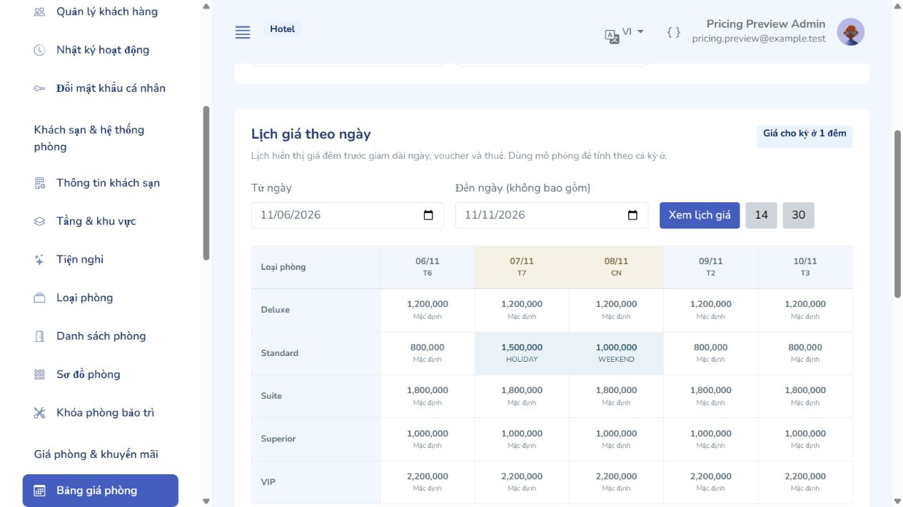
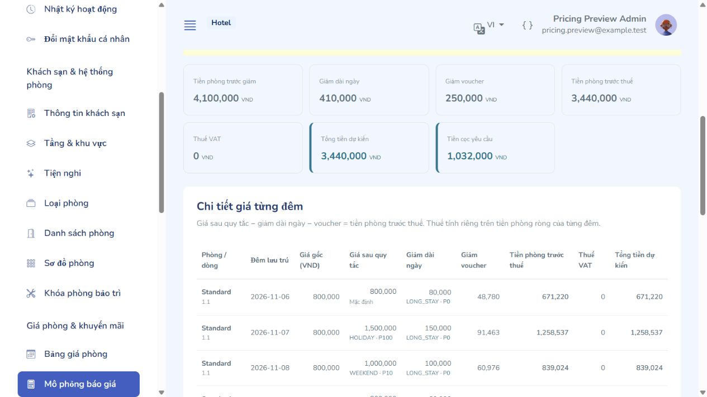

# CMS Admin – Giá phòng, khuyến mãi và chính sách (mô-đun 3)

Triển khai trên Spring Boot 4 / Java 17, Thymeleaf + Mazer và schema hiện có. Không thêm bảng hoặc sửa các migration V1–V5. Các màn hình có tiếng Việt/Anh, chế độ sáng/tối, phân quyền tại controller/service, CSRF và audit cùng transaction.

## Chạy và mở màn hình

Tại thư mục `backend`:

```powershell
.\mvnw.cmd spring-boot:run
```

Đăng nhập ADMIN và mở `http://localhost:8080/admin/pricing`. Nhóm menu **Giá phòng & khuyến mãi** có bảng giá, mô phỏng, voucher và chính sách. Khởi động lại backend nếu đang chạy bản cũ; không import lại database. Giá và chương trình minh họa trong ảnh được tạo trên H2 tách biệt, không thêm vào database thật.

| Đường dẫn | Chức năng | Quyền |
|---|---|---|
| GET `/admin/pricing` | Giá cơ bản, lịch 1–31 ngày, lọc quy tắc theo tên/mã, loại và trạng thái | `pricing.manage` hoặc `room.read` |
| POST `/admin/pricing/base-prices` | Lưu giá một loại phòng; audit `ROOM_TYPE_BASE_PRICE_UPDATE` | `pricing.manage` hoặc `room.manage` |
| `/admin/pricing/rules/create`, `/rules/{id}/edit` | Thêm/sửa quy tắc, chọn thứ và loại phòng, phiên bản | `pricing.manage` |
| POST `/admin/pricing/rules/{id}/toggle`, `/delete` | Bật/tắt; xóa bản chưa được dùng | `pricing.manage` |
| GET/POST `/admin/pricing/simulator` | Báo giá nhiều loại phòng, ngày riêng từng dòng, số lượng, voucher, thời điểm thử hủy | `pricing.manage` hoặc `booking.create` |
| `/admin/vouchers`, `/create`, `/{id}/edit` | Danh sách, lọc, quota, cấu hình voucher | `voucher.manage` |
| POST `/admin/vouchers/{id}/toggle`, `/delete` | Bật/tắt; xóa voucher chưa có lịch sử | `voucher.manage` |
| `/admin/policies` | Chính sách cọc, hủy, phụ phí và các phiên bản | `policy.manage` |
| `/admin/policies/deposits/create`, `/{id}/edit` | Cọc NONE/PERCENT/FIXED, hạn thanh toán | `policy.manage` |
| `/admin/policies/cancellations/create`, `/{id}/edit` | Quyền tự hủy, hạn hủy, bậc phí động và phí no-show | `policy.manage` |
| `/admin/policies/surcharges/create`, `/{id}/edit` | Nhận sớm, trả muộn, thêm khách, thêm giường | `policy.manage` |
| POST `/admin/policies/{nhóm}/{id}/toggle`, `/delete` | Bật/tắt hoặc xóa khi không được tham chiếu | `policy.manage` |
| POST `/admin/policies/deposits/{id}/default`, `/cancellations/{id}/default` | Đặt làm mặc định khách sạn | `policy.manage` |

GET chỉ đọc. POST tạo/sửa chấp nhận cả URL biểu mẫu `/create`, `/{id}/edit` và các URL lưu tương ứng không có hậu tố. USER không được vào CMS; lễ tân mặc định chỉ xem bảng giá và mô phỏng, không sửa giá/voucher/chính sách. Quản trị viên có thể gán quyền bổ sung bằng RBAC.

## Thiết lập giá

1. Nhập giá mặc định cho từng loại phòng. Giá khởi tạo 0 của V5 là dữ liệu chờ cấu hình; không có giá thị trường giả định được tự gán.
2. Tạo quy tắc **NIGHT_OVERRIDE** cho cuối tuần hoặc mùa/lễ. Mức tiền phải là FIXED. Chọn thứ, khoảng ngày `[từ, đến)`, loại phòng, số đêm tối thiểu/tối đa và độ ưu tiên.
3. Nút chọn nhanh thứ tương ứng: cả tuần 127; T7/CN 96; T6/T7/CN 112; T2–T6 31. Thứ ISO Hai = bit 1, …, Chủ Nhật = bit 64.
4. Ví dụ cuối tuần ưu tiên 10 và lễ ưu tiên 100: một đêm vừa là lễ vừa là thứ Bảy lấy giá lễ; không cộng hai giá.
5. Tạo **LENGTH_DISCOUNT** cho ưu đãi dài ngày: giảm % hoặc số VND mỗi đêm, xét tổng số đêm của từng phòng. Quy tắc vẫn phải khớp ngày và thứ của đêm đó. Không tự lấy tổng số đêm của nhiều phòng cộng lại để đạt điều kiện dài ngày.
6. Lịch giá thể hiện giá cho kỳ ở **1 đêm**, trước giảm dài ngày/voucher/thuế. Chọn 14/30 ngày hoặc một khoảng 1–31 ngày; dùng mô phỏng để xem giá cả kỳ ở.

## Phiên bản và lịch sử

Tất cả thao tác ghi lấy khóa `HotelInventoryCoordinator.lock()` trước khi đọc trạng thái để ra quyết định. Thay đổi và audit ghi trong một transaction.

- Quy tắc đã được `booking_room_nights.rate_rule_id` hoặc `length_discount_rule_id` dùng: giữ nguyên nội dung bản cũ, tắt bản cũ, tạo cùng code với `MAX(version)+1`.
- Cọc/hủy đã được `bookings` dùng và phụ phí đã được `booking_charges` dùng: tạo phiên bản mới tương tự. Nếu bản cũ đang mặc định khách sạn, chuyển default ID sang bản mới trong cùng transaction; booking cũ giữ ID/snapshot cũ.
- Chưa được tham chiếu: sửa cùng ID. Bậc hủy được thay thế an toàn, không đụng unique ngưỡng thời gian.
- Mã được chuẩn hóa viết hoa và giữ nguyên sau khi tạo. Phiên bản cũ chỉ để xem, không sửa/bật lại khi vẫn còn phiên bản mới hơn.
- Bật/tắt nhanh không thay điều khoản tài chính. Không tắt hoặc xóa chính sách đang mặc định; phải chọn mặc định khác. Không xóa dữ liệu đã có tham chiếu.
- Cập nhật giá cơ bản không sửa giá snapshot của các đêm đã đặt.

## Voucher

Mã được trim và viết hoa; hỗ trợ %/FIXED, trần giảm, tiền phòng tối thiểu, hạn nhận mã, ngày ở, tổng lượt, lượt mỗi khách, giới hạn loại phòng và cho phép kết hợp giảm dài ngày. Không chọn loại phòng = áp dụng các loại phòng đang hoạt động.

Hạn nhận mã là `[starts_at, expires_at)`, lưu UTC và nhập/hiển thị theo timezone khách sạn. Cả kỳ ở của từng dòng phải nằm trong cửa sổ ngày ở nếu có. Tiền tối thiểu tính trên tổng **tiền sau giảm dài ngày của các đêm đủ điều kiện**, không cộng phòng ngoài loại được chọn. Nếu không kết hợp dài ngày, bỏ các đêm thực sự đang hưởng giảm dài ngày khỏi tập hưởng voucher.

Quota tiêu thụ = RESERVED + REDEEMED; RELEASED được trả lượt. Danh sách hiển thị cả ba trạng thái và số còn lại. Có bất kỳ redemption nào, kể cả RELEASED: khóa các điều kiện; chỉ cho đổi active, kéo dài hết hạn hoặc tăng tổng lượt (có thể chuyển sang không giới hạn). Không giảm hạn mức khách, đổi ngày ở, tiền giảm hoặc tập loại phòng của voucher đã dùng.

Mô phỏng không tạo redemption. Không nhập customerId thì báo rõ chưa kiểm tra được quota mỗi khách; có customerId thì xác thực hồ sơ và kiểm tra quota. Lượt dùng được đọc ở trạng thái hiện tại ngay cả khi thử một evaluationTime khác; công cụ không dựng lại lịch sử sử dụng voucher trong quá khứ.

## Bộ tính giá

`RoomPricingEngineService` tải một snapshot nhất quán trong transaction đọc REPEATABLE_READ. `PricingCalculator` là phần tính toán thuần, nhận/trả các record bất biến trong `PricingModels`, không truy cập DB hoặc mạng.

Trình tự cho từng đêm:

1. Chụp base_price; chọn tối đa một NIGHT_OVERRIDE khớp loại, ngày, thứ và tổng số đêm, theo `priority DESC, id DESC`.
2. Chọn tối đa một LENGTH_DISCOUNT theo cùng thứ tự. Tính trên giá sau override; chặn không vượt tiền đêm.
3. Kiểm tra voucher, xác định tiền đủ điều kiện, tính tổng giảm có trần và không vượt phần tiền đó.
4. Phân bổ theo tỷ trọng. Các đêm trước dùng HALF_UP, đồng thời chặn bởi số tiền còn lại và năng lực các đêm sau; đêm cuối nhận phần dư. Cách chặn này tránh trường hợp nhiều phần 0,5 đồng làm đêm cuối âm. Tổng phân bổ luôn bằng tổng giảm.
5. `net_room_amount = nightly_rate - length_discount_amount - voucher_discount_amount` cho từng đêm. Thuế làm tròn trên tiền ròng từng đêm; cộng các dòng thuế để ra tổng thuế.
6. Tính tiền cọc và các mốc hủy từ chính sách mặc định cùng snapshot timezone/giờ check-in/out.

Số tiền tính toán làm tròn đồng VND bằng BigDecimal/HALF_UP; base_price_snapshot giữ dữ liệu gốc, nightly_rate là giá đã làm tròn. Không dùng float/double. Tổng thuế theo từng dòng có thể lệch 1 đồng so với làm tròn một lần trên tổng; bảng chi tiết và tổng luôn khớp nhau.

**Cơ sở đặt cọc của mô-đun:** % tính trên tổng tiền phòng sau giảm cộng thuế; FIXED chặn không vượt tổng đó; NONE = 0 và không có hạn thu cọc. Hạn thu cọc = evaluationTime + payment_due_minutes. Cọc không trừ vào tổng tiền phòng.

**Mô phỏng hủy:** hiển thị khi hủy **riêng từng phòng**, có deadline khách tự hủy và lịch các bậc. Chọn ngưỡng giờ lớn nhất thỏa điều kiện; đúng mốc 48h vẫn hưởng bậc 48h. Sau giờ nhận phòng dùng nhánh no-show. % tính trên tiền phòng sau giảm trước thuế; FIRST_NIGHT lấy tiền ròng đêm đầu; phí chặn trong [0, tiền phòng]. Khoản còn sau phí không phải tiền hoàn thực tế. Hủy toàn đơn/thu tiền/hoàn tiền cần quy trình booking và payment ledger ở mô-đun tiếp theo; không cộng tùy tiện phí FIXED của nhiều lần hủy riêng phòng thành phí hủy cả đơn.

Mỗi báo giá tối đa 20 dòng, 20 phòng/dòng, tổng 50 phòng, 366 đêm/kỳ ở và 3.660 đêm phòng. Danh sách bậc hủy tối đa 30. Binding các chỉ số quá lớn trả 400 để không mở rộng mảng vô hạn.

## Tích hợp đặt phòng sau này

- Booking phải lấy cùng khóa cấp khách sạn trước khi kiểm tra và ghi; khóa voucher, kiểm tra lại quota, ngày hiệu lực, khách sở hữu và giá tại thời điểm tạo booking, rồi lưu redemption RESERVED cùng inventory/nights/charges trong một transaction.
- evaluationTime của API đặt thật phải do server cấp; không nhận thời điểm giả lập hoặc customerId không gắn với khách được phép thao tác từ FE.
- Kết quả quote không giữ phòng, không xác nhận còn phòng, không giữ quota voucher và không phải xác nhận đặt phòng. Kiểm tra chỗ liên tục qua cơ chế claims/inventory của phần 2.
- Lưu ID/version quy tắc, tiền từng đêm và toàn bộ snapshot chính sách. Không tự định giá lại booking đã xác nhận khi admin sửa cấu hình.
- Voucher đã được phân bổ vào net_room_amount: không ghi thêm một dòng giảm cho cùng voucher làm giảm hai lần. Thuế là charge riêng; cọc và hoàn là payment ledger.
- Phụ phí hiện có CRUD + versioning; số phút thực tế, làm tròn giờ, dịch vụ và công nợ thuộc luồng nhận/trả phòng. Mô phỏng này không cộng phụ phí chưa phát sinh.

## Kiểm thử

Kết quả ngày 04/11/2026:

| Kiểm tra | Kết quả |
|---|---|
| `mvnw.cmd clean test` trên H2 | 97 đạt, 0 lỗi/thất bại; 1 kiểm tra MySQL opt-in bỏ qua ở lượt mặc định |
| Kiểm thử CMS giá/khuyến mãi trên MySQL riêng | 19/19 đạt |
| Kiểm thử HTTP form khách sạn + logo + VAT trên MySQL riêng | 1/1 đạt |
| Kiểm thử bộ tính giá thuần | 15/15 đạt |
| Trình duyệt | Tạo giá cuối tuần/mùa/dài ngày, voucher, default cọc/hủy, thêm bậc động, báo giá nhiều phòng; Việt/Anh, sáng/tối; 390 px không tràn ngang toàn trang |


```powershell
.\mvnw.cmd clean test
```

`RoomPricingEngineServiceTest` kiểm tra ưu tiên và tie-break, biên ngày/số đêm, giảm cố định/% có chặn, quota/hiệu lực/loại phòng, không kết hợp, phân bổ lẻ nhiều đêm, thuế/cọc, mốc hủy/no-show và cân bằng mọi dòng tiền. `CmsPricingAndPromotionIntegrationTest` kiểm tra đủ màn hình hai ngôn ngữ, phiên bản và snapshot booking/charge, chuyển default, voucher đã dùng, CSRF/quyền và dữ liệu không hợp lệ. Có kiểm tra riêng quyền sửa giá khi không có room.read/room.manage.

`HotelSettingsMultipartHttpIntegrationTest` gửi HTTP thật qua embedded Tomcat với hơn 10 phần form, logo PNG và VAT. Cấu hình `server.tomcat.max-part-count=64` cho phép form cấu hình khách sạn hiện có; các giới hạn ảnh 5 MB và toàn request 42 MB vẫn áp dụng.

Bằng chứng giao diện từ dữ liệu giả trên H2 riêng:





Ảnh [chế độ tối](screenshots/cms-pricing-dark.jpg), [điện thoại](screenshots/cms-pricing-mobile.jpg). Đã thử nhập giá cơ bản, nút chọn cuối tuần, thêm bậc hủy, nhiều dòng phòng, voucher có trần và tạo default cọc/hủy; kích thước 390 px không tràn ngang toàn trang, bảng chi tiết có thanh cuộn riêng.
